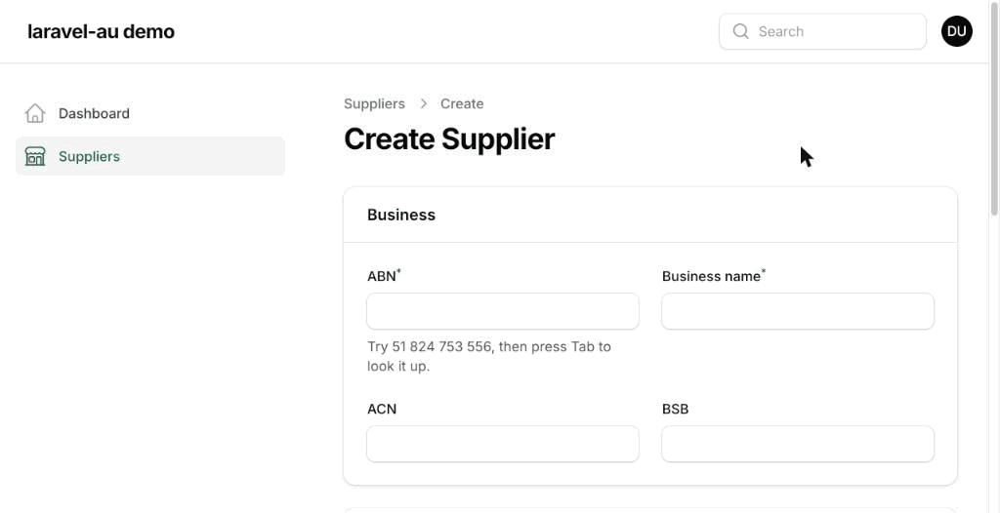
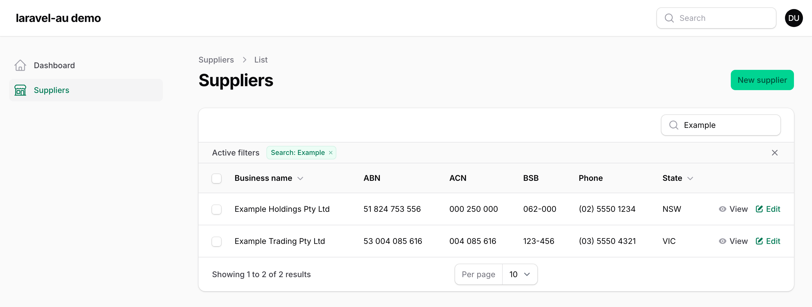

# laravel-au

[](https://github.com/Luke-Johnstone/laravel-au/actions/workflows/ci.yml)
[](https://packagist.org/packages/eastpointlabs/laravel-au)
[](LICENSE.md)
[](https://packagist.org/packages/eastpointlabs/laravel-au)
[](https://packagist.org/packages/eastpointlabs/laravel-au)
[](https://packagist.org/packages/eastpointlabs/laravel-au)

Validate Australian business details in Laravel, check ABNs against the Australian Business
Register, and add ready-made fields to Filament forms.



## What it does

**Catches bad details before they're saved.** Rules for ABNs, ACNs, BSBs, phone numbers and
postcodes, including whether a postcode belongs to the selected state.

```php
use EastpointLabs\LaravelAu\Rules\Abn;
use EastpointLabs\LaravelAu\Rules\AuPhone;
use EastpointLabs\LaravelAu\Rules\AuPostcode;
use EastpointLabs\LaravelAu\Support\State;
use Illuminate\Validation\Rule;

$request->validate([
    'abn'      => ['required', new Abn],
    'phone'    => ['required', AuPhone::mobile()],
    'state'    => ['required', Rule::enum(State::class)],
    'postcode' => ['required', AuPostcode::matchingStateField('state')],
]);
```

**Checks a business on the register.** A valid checksum doesn't mean a business exists. With a
free GUID, the [active ABN rule](#active-abn-rule) rejects an ABN that's cancelled or not on the
register, and can require GST registration. [`Abr`](#abn-lookup) gives you the business's
details in your own code.

```php
use EastpointLabs\LaravelAu\Facades\Abr;
use EastpointLabs\LaravelAu\Rules\ActiveAbn;

$request->validate([
    'abn' => ['required', (new ActiveAbn)->requireGst()],
]);

Abr::abn('51 824 753 556')?->displayName(); // the business name, or null if not found or hidden
```

**Adds Australian fields to Filament.** [Form fields](#filament-fields) format and validate as
people type. `AbnInput` can fill in the business name from the ABN, and `AuAddressFields` adds a
full address with the postcode checked against the state.

```php
use EastpointLabs\LaravelAu\Filament\Forms\AbnInput;
use EastpointLabs\LaravelAu\Filament\Forms\AuAddressFields;
use Filament\Forms\Components\TextInput;

AbnInput::make('abn')->lookup('business_name'),
TextInput::make('business_name'),
AuAddressFields::make(),
```

It also includes [value objects](#abn-acn-and-bsb), [Eloquent casts](#eloquent-casts) and a
[Faker provider](#faker-provider) for test data. Use what you need and ignore the rest.

## Why

Almost every Australian Laravel project ends up rewriting the same helpers: an ABN checksum, a
phone formatter, a postcode check. This package collects them in one well-tested place, with
optional Filament form fields on top.

## Requirements

- PHP 8.3+
- Laravel 12 or 13
- Filament 4 or 5 (optional, only for the form fields, table columns and infolist entries)

## Installation

```bash
composer require eastpointlabs/laravel-au
```

Publish the config file if you want to change the defaults, and the translations if you want to
change or translate the validation messages or Filament field labels:

```bash
php artisan vendor:publish --tag="au-config"
php artisan vendor:publish --tag="au-translations"
```

To use ABN Lookup, request a free GUID from the
[Australian Business Register](https://abr.business.gov.au/Tools/WebServices) and add it to your
`.env` file:

```dotenv
ABR_GUID=your-guid-here
```

## Configuration

Everything has a default, so you only need to publish `config/au.php` to change one. It has two
sections:

- `abr`: the ABN Lookup GUID, timeout and caching, all set from `.env`. See
  [Caching and settings](#caching-and-settings).
- `phone.store_as`: whether phone numbers are saved in E.164 (`e164`, the default) or as
  national digits (`national`). The [Eloquent cast](#storing-phone-numbers) and the
  [Filament phone field](#filament-fields) both use it.

## Usage

### Validation rules

Each rule checks input with the matching value object described below, so it reads input the
same way: an ABN typed with spaces passes, and one with a letter fails. Every rule comes as a
rule object and as a string rule:

| Rule object      | String rule   | Passes                                    |
|------------------|---------------|-------------------------------------------|
| `new Abn`        | `abn`         | a valid ABN                               |
| `new Acn`        | `acn`         | a valid ACN                               |
| `new AbnOrAcn`   | `abn_or_acn`  | a valid ABN (11 digits) or ACN (9 digits) |
| `new Bsb`        | `bsb`         | a BSB with 6 digits                       |
| `new AuPhone`    | `au_phone`    | a mobile or landline number               |
| `new AuPostcode` | `au_postcode` | a postcode in any state                   |
| `new ActiveAbn`  | `abn_active`  | an active ABN, checked with ABN Lookup    |

```php
use EastpointLabs\LaravelAu\Rules\AbnOrAcn;
use EastpointLabs\LaravelAu\Rules\Bsb;

$request->validate([
    'supplier_number' => ['required', new AbnOrAcn],
    'bsb'             => ['nullable', new Bsb],
]);

// The same, with string rules
$request->validate([
    'supplier_number' => 'required|abn_or_acn',
    'bsb'             => 'nullable|bsb',
]);
```

The rule objects live in `EastpointLabs\LaravelAu\Rules`. `Abn`, `Acn` and `Bsb` share their
names with the value objects in `EastpointLabs\LaravelAu\Support`, so alias one if a file needs
both.

`null` passes, so pair each rule with `required` or `nullable` as you would any other. Values
that aren't strings, such as ints and arrays, fail.

#### Phone number rules

`AuPhone` allows mobiles and landlines by default. Use a named constructor, or pass the
`PhoneType` cases you want:

```php
use EastpointLabs\LaravelAu\Rules\AuPhone;
use EastpointLabs\LaravelAu\Support\PhoneType;

new AuPhone;                                        // mobile or landline
AuPhone::mobile();                                  // mobile only
AuPhone::landline();                                // landline only
AuPhone::any();                                     // mobile, landline or service
new AuPhone(PhoneType::Mobile, PhoneType::Service); // mobile or service
```

The string rule takes the types as parameters: `au_phone:mobile` or
`au_phone:mobile,landline,service`. An unknown type throws an `InvalidArgumentException`,
because it's a mistake in your code rather than in the input. See
[Mobiles, landlines and service numbers](#mobiles-landlines-and-service-numbers) for how a
number's type is decided.

#### Postcode rules

`AuPostcode` passes a postcode from any state. Give it a state to require a postcode from that
state:

```php
use EastpointLabs\LaravelAu\Rules\AuPostcode;
use EastpointLabs\LaravelAu\Support\State;

new AuPostcode;             // any state
new AuPostcode(State::NSW); // New South Wales only
new AuPostcode('NSW');      // the same: a state code or name, in any case
```

The string forms are `au_postcode` and `au_postcode:NSW`. With NSW as the state, `3000` fails
with "The postcode must be in New South Wales."

Only pass states from your own code, never user input. An unknown state string, such as
`new AuPostcode('Atlantis')`, throws an `InvalidArgumentException`, because it's treated as a
typo in your code rather than a validation failure. To check a state the user chose, use
`matchingStateField()`.

#### Matching a postcode to the chosen state

There's no custom rule for state fields: use Laravel's `Rule::enum(State::class)`. Then
`AuPostcode::matchingStateField()` checks the postcode against the state the user picked:

```php
use EastpointLabs\LaravelAu\Rules\AuPostcode;
use EastpointLabs\LaravelAu\Support\State;
use Illuminate\Validation\Rule;

$request->validate([
    'state'    => ['required', Rule::enum(State::class)],
    'postcode' => ['required', AuPostcode::matchingStateField('state')],
]);
```

With `state` set to `NSW`, the postcode `2000` passes and `3000` fails with "The postcode must
be in New South Wales."

The state is read with `State::fromLoose()`, so a code or full name in any case works. An empty
or unrecognised state is ignored, and the postcode only has to be valid in some state, so the
rule never throws on user input. That's why the state field needs its own
`Rule::enum(State::class)`: it's what reports a bad state.

In nested arrays, a field name without a dot is read from the sibling, so each address is
checked against its own state:

```php
$request->validate([
    'addresses.*.state'    => ['required', Rule::enum(State::class)],
    'addresses.*.postcode' => ['required', AuPostcode::matchingStateField('state')],
]);
```

Here `addresses.0.postcode` is checked against `addresses.0.state`. A field name with a dot,
such as `matchingStateField('billing.state')`, is an absolute path from the top of the data.

#### Active ABN rule

A checksum shows an ABN is well formed, not that the business exists. `ActiveAbn` checks that
the ABN is on the Australian Business Register and that its status is active. `requireGst()`,
or `abn_active:gst`, also requires it to be registered for GST:

```php
use EastpointLabs\LaravelAu\Rules\ActiveAbn;

$request->validate([
    'abn' => ['required', (new ActiveAbn)->requireGst()],
]);

// The same, with a string rule
$request->validate([
    'abn' => 'required|abn_active:gst',
]);
```

With `abn` as the field, the rule fails with:

- "The abn must be a valid ABN." when the ABN is badly formatted. It isn't looked up.
- "The abn must be an active ABN." when the ABN isn't on the register, or isn't active.
- "The abn must be registered for GST." when it's active but not registered for GST, with
  `requireGst()` or `abn_active:gst`.

A suppressed ABN is judged on its status like any other, so a suppressed ABN that's active
passes. `null` is left to `required` and `nullable`, as with the other rules.

The rule uses [ABN Lookup](#abn-lookup), so it needs the `ABR_GUID` from
[Installation](#installation).

When the ABN can't be checked, because no GUID is set, ABN Lookup can't be reached or times out,
or it answers with an error, the rule fails with "The abn could not be checked right now. Please
try again." It also logs a warning that names the exception class only, without the GUID or the
ABN. Failing is the safe default, because an unchecked ABN never gets through. Where letting
someone through matters more than the check, call `passWhenUnavailable()` to pass instead:

```php
$request->validate([
    'abn' => ['required', (new ActiveAbn)->passWhenUnavailable()],
]);
```

The warning is still logged, and an ABN that's looked up and isn't active still fails. There's
no string rule form of `passWhenUnavailable()`, so use the rule object.

On a cache miss, the lookup is a network call made during validation, so it can add up to
`ABR_TIMEOUT` seconds (10 by default) to the response. Successful lookups are cached, for a day
by default, so checking the same ABN again is fast. Not-found results and errors aren't cached.
See [Caching and settings](#caching-and-settings). For forms, consider a lower timeout, such as
`ABR_TIMEOUT=3`, so a slow ABN Lookup doesn't keep people waiting. The timeout applies to every
lookup, not just this rule.

In tests, use `Abr::fake()` so no request is sent (see [Testing your app](#testing-your-app)).
An ABN you configure is active and not registered for GST unless you say otherwise:

```php
use EastpointLabs\LaravelAu\Facades\Abr;
use EastpointLabs\LaravelAu\Rules\ActiveAbn;
use Illuminate\Support\Facades\Validator;

it('only accepts active ABNs', function (): void {
    Abr::fake([
        '51824753556' => [],
        '83914571673' => ['AbnStatus' => 'Cancelled'],
    ]);

    $rules = ['abn' => ['required', new ActiveAbn]];

    expect(Validator::make(['abn' => '51 824 753 556'], $rules)->passes())->toBeTrue()
        ->and(Validator::make(['abn' => '83 914 571 673'], $rules)->passes())->toBeFalse();
});
```

Set `'Gst' => '2000-07-01'` on an ABN to make it registered for GST, and use
`Abr::fake()->failing()` to test what happens when the ABN can't be checked.

#### Messages

The messages are in Australian English, under the `au::validation` translation namespace. For
example, "The abn must be a valid ABN." and "The postcode must be in New South Wales."

To change them, publish the translations with the `au-translations` tag (see
[Installation](#installation)) and edit `lang/vendor/au/en/validation.php`. To translate them,
add the same file for another locale, such as `lang/vendor/au/fr/validation.php`.

For the string rules, your app's own messages win, as they do for Laravel's built-in rules: an
inline custom message, or a line keyed by the rule name (such as `abn`) in your app's
`lang/en/validation.php`. Your message replaces every message that rule can fail with, so a
line for `abn_active` also covers an ABN that couldn't be checked.

### ABN, ACN and BSB

`Abn`, `Acn` and `Bsb` are immutable value objects. They accept a number the way people type
it, keep only the digits, and format it for display.

```php
use EastpointLabs\LaravelAu\Support\Abn;

$abn = Abn::from('51 824 753 556');

$abn->value;                  // "51824753556"
$abn->format();               // "51 824 753 556"
(string) $abn;                // "51824753556"
json_encode(['abn' => $abn]); // {"abn":"51824753556"}
```

Store `value`, and use `format()` when you show the number to people. Input may contain spaces,
hyphens, dots and non-breaking spaces. Any other character, such as a letter or a tab, makes it
invalid.

Check or parse input with `isValid()`, `tryFrom()` or `from()`:

```php
Abn::isValid('51 824 753 556'); // true
Abn::isValid('51 824 753 557'); // false: bad checksum

Abn::tryFrom('51 824 753 557'); // null
Abn::from('51 824 753 557');    // throws InvalidValueException
```

`tryFrom()` returns `null` for null, blank or invalid input, so it suits optional fields.
`from()` throws `EastpointLabs\LaravelAu\Exceptions\InvalidValueException`, which extends
`InvalidArgumentException`. Its message never includes the input, which may be personal
information.

Two objects are equal when their digits match:

```php
Abn::from('51824753556')->equals(Abn::from('51-824-753-556')); // true
```

`Acn` and `Bsb` work the same way:

```php
use EastpointLabs\LaravelAu\Support\Acn;
use EastpointLabs\LaravelAu\Support\Bsb;

Acn::from('004085616')->format(); // "004 085 616"
Acn::isValid('000 000 018');      // false: bad check digit

Bsb::from('062000')->format();    // "062-000"
```

A BSB has no check digit, so `Bsb` only checks that there are six digits. It can't tell you
whether the branch exists.

#### Finding the ACN in an ABN

A company's ABN is usually two digits followed by its ACN. `acn()` returns that ACN when the
last nine digits form a valid one, and `null` otherwise:

```php
Abn::from('53 004 085 616')->acn()?->format(); // "004 085 616"
Abn::from('51 824 753 556')->acn();            // null
```

This is a check-digit match, not a register lookup. It doesn't prove the ABN and ACN belong to
the same company.

### States and postcodes

`State` is a string-backed enum with one case for each state and mainland territory: `NSW`,
`VIC`, `QLD`, `SA`, `WA`, `TAS`, `NT` and `ACT`. Each case's value is its code, so it stores
as a short string and works with Laravel's enum cast and `Rule::enum()`.

```php
use EastpointLabs\LaravelAu\Support\State;

State::VIC->value;   // "VIC"
State::VIC->label(); // "Victoria"

State::options();    // ['NSW' => 'New South Wales', 'VIC' => 'Victoria', ...]
```

`options()` maps codes to labels in case order, ready for a select field.

To read a state the way people type it, use `fromLoose()`. It matches a code or full name in
any case, ignores surrounding whitespace and allows one trailing dot. It returns `null` for
null, blank or unknown input.

```php
State::fromLoose('nsw');             // State::NSW
State::fromLoose('New South Wales'); // State::NSW
State::fromLoose(' Vic. ');          // State::VIC
State::fromLoose('New Zealand');     // null
```

`Postcode` is a value object that works like `Abn`, with `from()`, `tryFrom()`, `isValid()`,
`value`, `format()` and `equals()`. It also knows which state it belongs to. The value is a
string, so leading zeros are kept.

```php
use EastpointLabs\LaravelAu\Support\Postcode;
use EastpointLabs\LaravelAu\Support\State;

$postcode = Postcode::from('0800');

$postcode->value;                       // "0800"
$postcode->format();                    // "0800"
(string) $postcode;                     // "0800"
json_encode(['postcode' => $postcode]); // {"postcode":"0800"}

$postcode->state();               // State::NT
$postcode->belongsTo(State::NT);  // true
$postcode->belongsTo(State::QLD); // false
```

`belongsTo()` checks a postcode against a state. To do this in form validation, use
[`AuPostcode::matchingStateField()`](#matching-a-postcode-to-the-chosen-state).

A postcode is valid when it has exactly 4 digits and falls in a state's postcode range.
Surrounding whitespace is ignored, including non-breaking spaces. Anything else, such as a
space inside the number, makes it invalid.

```php
Postcode::isValid('2600'); // true
Postcode::isValid('800');  // false: needs all 4 digits
Postcode::isValid('0500'); // false: in no state's range

Postcode::tryFrom('800');  // null
Postcode::from('800');     // throws InvalidValueException
```

The ranges show a postcode is plausible, not that it exists, so a valid `Postcode` may not be
in use. Jervis Bay (2540) and Norfolk Island (2899) fall inside NSW ranges, so they count as
NSW.

#### Finding the state for a postcode

`State::fromPostcode()` returns the state for a postcode, or `null` when it's in no state's
range. A string follows the same rules as `Postcode`. An int can't hold a leading zero, so
it's zero-padded to 4 digits.

```php
State::fromPostcode('2000'); // State::NSW
State::fromPostcode('0800'); // State::NT
State::fromPostcode('800');  // null: a string needs all 4 digits
State::fromPostcode(800);    // State::NT: read as "0800"
State::fromPostcode(10000);  // null
```

Don't write the leading zero in an int. PHP reads an int literal that starts with `0` as
octal: `0200` is 128, which is in no state's range, and `0800` is a parse error. Pass the
string `'0800'` or the int `800` instead.

`postcodeRanges()` returns a state's inclusive ranges as ints, so `200` means 0200:

```php
State::ACT->postcodeRanges(); // [[200, 299], [2600, 2618], [2900, 2920]]
```

### Phone numbers

`PhoneNumber` is a value object for Australian mobile, landline and service (13, 1300 and 1800)
numbers. It works like `Abn`, with `from()`, `tryFrom()`, `isValid()`, `value`, `format()` and
`equals()`. The examples below use numbers that the Australian Communications and Media
Authority (ACMA) reserves for use in fiction.

```php
use EastpointLabs\LaravelAu\Support\PhoneNumber;

$phone = PhoneNumber::from('+61 491 570 156');

$phone->value;                    // "0491570156"
$phone->format();                 // "0491 570 156"
$phone->formatInternational();    // "+61 491 570 156"
$phone->toE164();                 // "+61491570156"
(string) $phone;                  // "0491570156"
json_encode(['phone' => $phone]); // {"phone":"0491570156"}
```

`value` holds the national digits, so a number is stored the same way however it was typed.
Use `format()` to show it to people in Australia and `formatInternational()` for people
overseas. `toE164()` gives the compact international form that SMS and calling services
usually expect.

Input may contain spaces, hyphens, dots, parentheses and non-breaking spaces. A leading `+61`
or `61` becomes the trunk `0`, and the `+61 (0)` form works too. Numbers from other countries
are rejected, and any other character, such as a letter or a tab, makes the input invalid.

```php
PhoneNumber::isValid('0491-570-156');       // true
PhoneNumber::isValid('+61 (0)2 5550 1234'); // true
PhoneNumber::isValid('0491 570 15');        // false: too few digits

PhoneNumber::tryFrom('0491 570 15'); // null
PhoneNumber::from('0491 570 15');    // throws InvalidValueException
```

Two numbers are equal when their national digits match:

```php
PhoneNumber::from('0491-570-156')->equals(PhoneNumber::from('+61 (0)491 570 156')); // true
```

#### Mobiles, landlines and service numbers

The leading digits decide the type. A mobile starts with `04` and a landline with `02`, `03`,
`07` or `08`, and both have 10 digits. A service number is `1300` or `1800` followed by 6
digits, or `13` followed by 4.

`type()` returns a `PhoneType`, a string-backed enum with the cases `Mobile` (`'mobile'`),
`Landline` (`'landline'`) and `Service` (`'service'`). `isMobile()`, `isLandline()` and
`isService()` are shortcuts for the same check.

```php
use EastpointLabs\LaravelAu\Support\PhoneNumber;
use EastpointLabs\LaravelAu\Support\PhoneType;

$landline = PhoneNumber::from('03 5550 1234');

$landline->type() === PhoneType::Landline; // true
$landline->isLandline();                   // true
$landline->areaCode();                     // "03"
$landline->format();                       // "(03) 5550 1234"
$landline->formatInternational();          // "+61 3 5550 1234"
```

`areaCode()` returns `"02"`, `"03"`, `"07"` or `"08"` for a landline, and `null` for anything
else.

Service numbers can't be dialled from overseas, so `toE164()` and `formatInternational()`
return `null` for them:

```php
$service = PhoneNumber::from('1800 160 401');

$service->isService();           // true
$service->format();              // "1800 160 401"
$service->toE164();              // null
$service->formatInternational(); // null

PhoneNumber::from('1300-975-707')->format(); // "1300 975 707"
PhoneNumber::from('13 1234')->format();      // "13 12 34"
```

### Eloquent casts

The casts store a value object's canonical string in the database and give you the value object
back when you read the attribute. `State` doesn't need a cast from the package: it's a
string-backed enum, so Laravel's enum cast handles it.

```php
use EastpointLabs\LaravelAu\Casts\AsAbn;
use EastpointLabs\LaravelAu\Casts\AsAcn;
use EastpointLabs\LaravelAu\Casts\AsBsb;
use EastpointLabs\LaravelAu\Casts\AsPhoneNumber;
use EastpointLabs\LaravelAu\Casts\AsPostcode;
use EastpointLabs\LaravelAu\Support\State;
use Illuminate\Database\Eloquent\Model;

class Supplier extends Model
{
    protected function casts(): array
    {
        return [
            'abn'      => AsAbn::class,
            'acn'      => AsAcn::class,
            'bsb'      => AsBsb::class,
            'phone'    => AsPhoneNumber::class,
            'postcode' => AsPostcode::class,
            'state'    => State::class, // Laravel's enum cast
        ];
    }
}
```

Set an attribute to a value object, or to a string in any form its `from()` accepts. The cast
stores the canonical value, and `null` stores `null`. Reading gives back the value object, and
a stored `null` reads as `null`:

```php
use EastpointLabs\LaravelAu\Support\Postcode;

$supplier = new Supplier;

$supplier->abn = '51 824 753 556';            // stored as "51824753556"
$supplier->postcode = Postcode::from('0800'); // stored as "0800"
$supplier->acn = null;                        // stored as null

$supplier->abn->format(); // "51 824 753 556"
$supplier->acn;           // null

$supplier->toArray(); // ['abn' => '51824753556', 'postcode' => '0800', 'acn' => null]
```

`toArray()` and `toJson()` hold the stored strings, not objects, so an API response shows the
same values as the database.

A row stored in another form, such as an ABN saved with spaces before you added the cast, reads
normally and isn't marked as changed just because you read it. It's stored in canonical form the
next time you set that attribute.

Setting an invalid value throws `InvalidValueException`, as `from()` does. Check input with the
[validation rules](#validation-rules) first, so people see a message rather than an error.
Reading a stored value that isn't valid throws too, as Laravel's enum cast does for a value
that isn't a case. Clean up existing data before you add a cast to a column that already has
rows.

Use string columns. ACNs, BSBs, postcodes and national phone numbers can start with `0`, which
an integer column drops. A stored integer is read as its digits, so an ABN in an integer column
still works, but an ACN that has lost its leading zeros isn't valid and throws.

#### Storing phone numbers

`AsPhoneNumber` stores numbers in E.164, such as `+61491570006`, by default. Set
`phone.store_as` in `config/au.php` to `national` to store national digits (`0491570006`)
instead. The [Filament phone field](#filament-fields) uses the same setting, so the two agree.
Service numbers have no E.164 form, so they're always stored as national digits.

```php
$supplier->phone = '0491 570 006'; // stored as "+61491570006"

$supplier->phone->value;    // "0491570006"
$supplier->phone->format(); // "0491 570 006"

$supplier->phone = '1300 975 707'; // stored as "1300975707"
```

The cast reads either form back as the same `PhoneNumber`, so rows stored before you change the
setting still load. `toArray()` and `toJson()` follow the setting too, so a phone number appears
as `+61491570006` by default. That differs from `json_encode()` on a `PhoneNumber` itself, which
gives the national digits.

### Faker provider

When Faker is installed, the package adds an Australian provider to Laravel's Faker generator,
so `fake()->abn()` and friends work in model factories and tests. Most Laravel apps already
have `fakerphp/faker` as a dev dependency. This package doesn't need it: without Faker, the
provider just isn't registered.

```php
use Illuminate\Database\Eloquent\Factories\Factory;

class SupplierFactory extends Factory
{
    public function definition(): array
    {
        return [
            'abn'      => fake()->abn(),
            'acn'      => fake()->acn(),
            'bsb'      => fake()->bsb(),
            'phone'    => fake()->auMobileNumber(),
            'state'    => $state = fake()->auState(),
            'postcode' => fake()->auPostcode($state), // in the state picked above
        ];
    }
}
```

The provider adds these methods:

- `abn()`: 11 digits with a valid checksum.
- `invalidAbn()`: 11 digits that fail the ABN checksum, for testing your validation.
- `acn()`: 9 digits with a valid check digit.
- `bsb()`: any 6 digits, which is all `Bsb` checks.
- `auMobileNumber()`: one of six mobile numbers ACMA reserves for fiction, such as
  `0491570156`.
- `auLandlineNumber(?State $state = null)`: a number from ACMA's fictional `5550` block, in the
  state's area code. `auLandlineNumber(State::VIC)` gives `035550` and four more digits.
- `auPostcode(?State $state = null)`: a postcode inside one of the state's ranges, so
  `State::fromPostcode()` returns that state.
- `auState()`: a `State` case.

Without a state, `auLandlineNumber()` and `auPostcode()` pick one at random.

Values are canonical digit strings, like a value object's `value`, and `auState()` returns a
`State`. To show one formatted, pass it to the value object:

```php
use EastpointLabs\LaravelAu\Support\PhoneNumber;
use EastpointLabs\LaravelAu\Support\State;

PhoneNumber::from(fake()->auLandlineNumber(State::VIC))->format(); // such as "(03) 5550 1234"
```

Seed Faker, such as with `fake()->seed(1234)`, to get the same values on every run.

> **Warning:** generated ABNs and ACNs pass the checks, but they may belong to real businesses.
> Never send them to the live ABN Lookup service. In tests, use `Abr::fake()` instead (see
> [Testing your app](#testing-your-app)). The phone numbers all come from the ranges ACMA
> reserves for fiction, so they're safe to use.

### ABN Lookup

`Abr` looks up businesses on the Australian Business Register through its free ABN Lookup web
services. It needs the `ABR_GUID` from [Installation](#installation), and so does the
[active ABN rule](#active-abn-rule). The other validation rules and the value objects don't, so
you can skip the GUID if those are all you use.

```php
use EastpointLabs\LaravelAu\Facades\Abr;

Abr::abn('51 824 753 556');            // ?AbnDetails
Abr::acn('004 085 616');               // ?AbnDetails for the company's ABN
Abr::searchByName('Example Holdings'); // list<NameMatch>

Abr::searchByName('Example Holdings', maxResults: 20);
```

`abn()` and `acn()` take a string in any form the value objects accept, or an `Abn` or `Acn`
object. `searchByName()` searches entity, business and trading names, and returns the matches
in the order ABN Lookup ranks them. `maxResults` defaults to 10 and is kept between 1 and 200
(`AbrClient::MAX_RESULTS`).

In application code, inject the `LooksUpAbns` contract instead of using the facade. It resolves
to the same client, and in tests `Abr::fake()` replaces it (see
[Testing your app](#testing-your-app)).

```php
use EastpointLabs\LaravelAu\Abr\Contracts\LooksUpAbns;

final class SupplierCheck
{
    public function __construct(private LooksUpAbns $abr) {}

    public function isActive(string $abn): bool
    {
        return $this->abr->abn($abn)?->isActive() ?? false;
    }
}
```

#### Reading the results

`abn()` and `acn()` return `null` when the number isn't on the register, so check for it first:

```php
$details = Abr::abn('51 824 753 556');

if ($details !== null) {
    $details->displayName();     // ?string: the first business name, else the entity name
    $details->isActive();        // bool: the status is "Active"
    $details->isGstRegistered(); // bool
    $details->isSuppressed();    // bool
}
```

`AbnDetails` also holds the register's fields as properties: `abn`, `acn`, `status`,
`statusEffectiveFrom`, `entityName`, `entityTypeCode`, `entityTypeName`, `businessNames`,
`gstRegisteredFrom`, `postcode` and `state`. Numbers are value objects, dates are
`DateTimeImmutable` and the state is a `State`. `toArray()` returns them all as plain values.

An ABN holder can ask the register to suppress their details. A suppressed ABN still returns
`AbnDetails`, with its status and GST registration, but no names or address. `isSuppressed()`
is then `true` and `displayName()` returns `null`, so don't assume there's always a name to
show.

Each name search result is a `NameMatch`:

```php
foreach (Abr::searchByName('Example Holdings') as $match) {
    $match->abn;       // Abn
    $match->name;      // string: the name that matched
    $match->nameType;  // string, such as "Entity Name" or "Business Name"
    $match->state;     // ?State
    $match->postcode;  // ?Postcode
    $match->score;     // int: higher is a closer match
    $match->isCurrent; // bool
}
```

#### Errors

`null` means the ABN or ACN wasn't found. Other problems throw:

- An invalid ABN or ACN throws `InvalidValueException`, and an empty name throws
  `InvalidArgumentException`. Both are thrown before any request is sent.
- `AbrException` means the lookup failed: the connection failed or timed out, ABN Lookup
  answered with an HTTP error status or a response that couldn't be read, or it reported an
  error of its own, such as an unrecognised GUID.
- `MissingGuidException` means no GUID is set. It's thrown when you call a lookup, not when the
  app boots. It extends `AbrException`, so catching `AbrException` handles both.

The package's exceptions live in `EastpointLabs\LaravelAu\Exceptions`. Failed requests aren't
retried. If you need retries, add them where you make the call, such as in a queued job.

#### Caching and settings

Successful `abn()` and `acn()` lookups are cached for a day by default, so looking up the same
number again sends no request. Not-found results, errors and name searches aren't cached.

The trade-off is that a cached result can be out of date: an ABN cancelled after it was cached
still shows as active until the entry expires. Lower `ABR_CACHE_TTL`, or turn caching off,
where that matters.

To change the defaults, set these in your `.env` file:

| Setting             | Default                            | Purpose                                 |
|---------------------|------------------------------------|-----------------------------------------|
| `ABR_TIMEOUT`       | `10`                               | Request timeout, in seconds             |
| `ABR_CACHE_ENABLED` | `true`                             | Set to `false` to turn caching off      |
| `ABR_CACHE_STORE`   | your app's default store           | The cache store to use, such as `redis` |
| `ABR_CACHE_TTL`     | `86400` (one day)                  | How long to keep a lookup, in seconds   |
| `ABR_BASE_URL`      | `https://abr.business.gov.au/json` | The ABN Lookup address                  |

#### Keeping the GUID private

The GUID never appears in the package's exception messages, stack trace arguments or cache
keys. ABN Lookup takes it as a query parameter, though, so anything that sees the request URL
sees the GUID. That includes tools that record outgoing HTTP requests, such as Laravel
Telescope, and the error Laravel throws for an unfaked request after
`Http::preventStrayRequests()`. In tests, use [`Abr::fake()`](#testing-your-app) so no request
is made.

#### Testing your app

`Abr::fake()` replaces ABN Lookup with a fake for the rest of the test. The fake answers from
details you give it and never sends a request. It's bound to the `LooksUpAbns` contract, so
code that injects the contract gets it too, not just code that uses the facade.

This test checks the `SupplierCheck` class from above:

```php
use EastpointLabs\LaravelAu\Facades\Abr;

it('only accepts active suppliers', function (): void {
    Abr::fake([
        '51824753556' => ['EntityName' => 'Example Holdings Pty Ltd'],
        '83914571673' => ['AbnStatus' => 'Cancelled'],
    ]);

    $check = app(SupplierCheck::class);

    expect($check->isActive('51 824 753 556'))->toBeTrue()
        ->and($check->isActive('83 914 571 673'))->toBeFalse();

    Abr::assertLookedUp('51 824 753 556');
    Abr::assertLookupCount(2);
});
```

Each key is an ABN. Each value is an `AbnDetails` object, or an array of ABN Lookup fields,
such as `EntityName`, `AbnStatus` and `Acn`, merged over an active record for that ABN. `acn()`
finds configured details by their `Acn` field, so set `'Acn' => '004085616'` on
`53 004 085 616` to look that company up by its ACN.

An ABN or ACN you haven't configured returns `null`, and a name search returns no matches.
After `preventStrayLookups()`, an unconfigured ABN or ACN throws a `RuntimeException` instead,
so a test can't pass by accident. It isn't an `AbrException`, so code that handles ABN Lookup
errors won't hide it.

Input is checked like the real client checks it, so an invalid ABN or ACN still throws
`InvalidValueException`.

These methods set up other answers. Each returns the fake, so they chain:

- `notFound(...$abns)`: these ABNs return `null`, even after `preventStrayLookups()`.
- `suppressed($abn, $status = 'Active', $gst = false)`: this ABN returns suppressed details,
  with a status and GST registration but no names or address.
- `withNameMatches($matches)`: what `searchByName()` returns, whatever the name. Each match is
  a `NameMatch`, or an array with the keys `Abn`, `Name`, `NameType`, `State`, `Postcode`,
  `Score` and `IsCurrent`.
- `failing()`: every lookup throws `AbrException`, for testing your error handling.

```php
Abr::fake(['51824753556' => ['EntityName' => 'Example Holdings Pty Ltd']])
    ->suppressed('83 914 571 673', status: 'Cancelled')
    ->notFound('53 004 085 616')
    ->preventStrayLookups();
```

Assert on the lookups through the facade, or on the fake that `Abr::fake()` returns:

- `assertLookedUp($abn)` and `assertNotLookedUp($abn)`: whether `abn()` was called with this
  ABN. Only `abn()` calls count.
- `assertNothingLookedUp()`: no `abn()`, `acn()` or `searchByName()` call was made.
- `assertLookupCount($count)`: how many `abn()`, `acn()` and `searchByName()` calls were made in
  all, including repeats.

### Filament fields

If your app uses Filament 4 or 5, these form fields bring the package's validation, formatting
and ABN Lookup into your forms. Filament is optional: the package doesn't require it, and
everything else works without it. The fields are building blocks for your own resource forms.
The package adds no pages, resources or plugin, so there's nothing to register.

```php
use EastpointLabs\LaravelAu\Filament\Forms\AbnInput;
use EastpointLabs\LaravelAu\Filament\Forms\AcnInput;
use EastpointLabs\LaravelAu\Filament\Forms\AuAddressFields;
use EastpointLabs\LaravelAu\Filament\Forms\AuPhoneInput;
use EastpointLabs\LaravelAu\Filament\Forms\BsbInput;
use Filament\Forms\Components\TextInput;
use Filament\Schemas\Schema;

public static function form(Schema $schema): Schema
{
    return $schema->components([
        AbnInput::make('abn')->lookup('business_name'),
        TextInput::make('business_name'),
        AcnInput::make('acn'),
        BsbInput::make('bsb'),
        AuPhoneInput::make('phone')->mobileOnly(),
        AuAddressFields::make('billing_'),
    ]);
}
```

The fields live in `EastpointLabs\LaravelAu\Filament\Forms`, and each one works with just
`make()`:

- `AbnInput` is masked as `51 824 753 556`, checked with the `Abn` rule and saved as 11 digits.
- `AcnInput` is masked as `004 085 616`, checked with the `Acn` rule and saved as 9 digits.
- `BsbInput` is masked as `062-000`, checked with the `Bsb` rule and saved as 6 digits.
- `AuPhoneInput` is a `tel` input that accepts mobiles and landlines. It saves in E.164, such as
  `+61491570006`, or as national digits (`0491570006`) when `phone.store_as` in `config/au.php`
  is `national`. Service numbers have no E.164 form, so they're always saved as national
  digits.
- `AuPostcodeInput` takes up to 4 characters, brings up the numeric keypad and is checked with
  the `AuPostcode` rule. It's saved as a string, so `0800` keeps its leading zero.
- `StateSelect` lists the eight states and territories by name, and saves the code (`NSW`,
  `VIC`...).

When a form loads a stored ABN, ACN, BSB or phone number, the field shows it formatted, such as
`51 824 753 556` or `0491 570 006`. A stored value that isn't valid is shown as it is.

#### Phone and postcode options

`AuPhoneInput` takes the same choices as the [`AuPhone` rule](#phone-number-rules):

```php
AuPhoneInput::make('phone');                                      // mobile or landline
AuPhoneInput::make('phone')->mobileOnly();                        // mobile only
AuPhoneInput::make('phone')->landlineOnly();                      // landline only
AuPhoneInput::make('phone')->allowServiceNumbers();               // mobile, landline or service
AuPhoneInput::make('phone')->mobileOnly()->allowServiceNumbers(); // mobile or service
```

`allowServiceNumbers()` adds 13, 1300 and 1800 numbers, whichever order you call it in.

`AuPostcodeInput::forState()` checks the postcode against the state chosen in another field:

```php
StateSelect::make('state'),
AuPostcodeInput::make('postcode')->forState('state'),
```

With `NSW` chosen, `3000` fails with "The postcode must be in New South Wales." While the state
field is empty, or holds something that isn't a state, a postcode from any state passes.
`StateSelect` reports a bad state itself.

#### Address fields

`AuAddressFields::make()` returns a two-column `Grid` holding the five fields of an address,
named with the prefix you give it. `AuAddressFields::make('billing_')` gives:

| Field                   | Label          | Required |
|-------------------------|----------------|----------|
| `billing_street_line_1` | Street address | Yes      |
| `billing_street_line_2` | Address line 2 | No       |
| `billing_suburb`        | Suburb         | Yes      |
| `billing_state`         | State          | Yes      |
| `billing_postcode`      | Postcode       | Yes      |

The street lines and suburb take the full width, with the state and postcode side by side. The
state is a `StateSelect`, and the postcode is checked against it with `forState()`. Without a
prefix, the fields are named `street_line_1`, `street_line_2` and so on. It's an ordinary
Filament `Grid`, so methods such as `->columnSpanFull()` chain on.

#### Filling in the business name

`lookup()` saves people typing a name the register already has. In the example above,
`AbnInput::make('abn')->lookup('business_name')` looks the ABN up when the field loses focus,
and fills `business_name` with the first business name, else the entity name. That replaces
anything already in the field. It needs the `ABR_GUID` from [Installation](#installation).

Only a valid ABN is looked up, and a lookup never breaks the form. When the ABN isn't on the
register, is suppressed and so has no name, or can't be looked up because no GUID is set or ABN
Lookup is unreachable, the other field is left as it is. A failed lookup is logged as a warning,
without the GUID. Successful lookups are cached like any other (see
[Caching and settings](#caching-and-settings)), so looking up the same ABN again sends no
request.

In tests, use `Abr::fake()` so no request is sent (see [Testing your app](#testing-your-app)).
For a resource page such as `CreateSupplier`:

```php
use EastpointLabs\LaravelAu\Facades\Abr;
use Livewire\Livewire;

it('fills the business name from the ABN', function (): void {
    Abr::fake(['51824753556' => ['EntityName' => 'Example Holdings Pty Ltd']]);

    Livewire::test(CreateSupplier::class)
        ->fillForm(['abn' => '51 824 753 556'])
        ->assertSchemaStateSet(['business_name' => 'Example Holdings Pty Ltd']);
});
```

Only ABN Lookup errors are caught, so after `preventStrayLookups()` a test that looks up an ABN
you haven't configured still fails.

#### Labels

Filament makes a label from the field name, so `abn` would be labelled "Abn". These fields set
their own, whatever the field is called: "ABN", "ACN", "BSB", "Phone", "Postcode" and "State",
plus "Street address", "Address line 2" and "Suburb" in `AuAddressFields`. `->label()` still
overrides them:

```php
AbnInput::make('supplier_abn')->label('Supplier ABN'),
```

The labels come from the package's translations, under `au::fields`, and are translated when
shown, so the current locale applies. To change or translate them, publish the translations
with the `au-translations` tag (see [Installation](#installation)) and edit
`lang/vendor/au/en/fields.php`.

#### Table columns and infolist entries

These show stored values formatted, to match the form fields. The columns live in
`EastpointLabs\LaravelAu\Filament\Tables` and the entries in
`EastpointLabs\LaravelAu\Filament\Infolists`:

| Column          | Entry          | Example           |
|-----------------|----------------|-------------------|
| `AbnColumn`     | `AbnEntry`     | `51 824 753 556`  |
| `AcnColumn`     | `AcnEntry`     | `004 085 616`     |
| `BsbColumn`     | `BsbEntry`     | `062-000`         |
| `AuPhoneColumn` | `AuPhoneEntry` | `0491 570 156`    |
| `StateColumn`   | `StateEntry`   | `New South Wales` |



```php
use EastpointLabs\LaravelAu\Filament\Tables\AbnColumn;
use EastpointLabs\LaravelAu\Filament\Tables\AuPhoneColumn;
use EastpointLabs\LaravelAu\Filament\Tables\StateColumn;
use Filament\Tables\Table;

public static function table(Table $table): Table
{
    return $table->columns([
        AbnColumn::make('abn')->linkToAbnLookup(),
        AuPhoneColumn::make('phone')->dialable(),
        StateColumn::make('state')->abbreviated(),
    ]);
}
```

```php
use EastpointLabs\LaravelAu\Filament\Infolists\AbnEntry;
use EastpointLabs\LaravelAu\Filament\Infolists\AcnEntry;
use EastpointLabs\LaravelAu\Filament\Infolists\AuPhoneEntry;
use EastpointLabs\LaravelAu\Filament\Infolists\BsbEntry;
use EastpointLabs\LaravelAu\Filament\Infolists\StateEntry;
use Filament\Schemas\Schema;

public static function infolist(Schema $schema): Schema
{
    return $schema->components([
        AbnEntry::make('abn')->linkToAbnLookup(),
        AcnEntry::make('acn'),
        BsbEntry::make('bsb'),
        AuPhoneEntry::make('phone')->dialable(),
        StateEntry::make('state'),
    ]);
}
```

Each works with just `make()`. The value can be a plain stored string, or the value object or
`State` that an [Eloquent cast](#eloquent-casts) gives you. A stored value that doesn't parse,
such as an ABN with a bad checksum, is shown as it is, never hidden. Each has the same default
label as its form field, such as "ABN" (see [Labels](#labels)), and `->label()` overrides it.

`StateColumn` and `StateEntry` show the state's name. `->abbreviated()` shows its code, such as
`NSW`, which suits a narrow column.

`->linkToAbnLookup()` links an ABN to its page on ABN Lookup, such as
`https://abr.business.gov.au/ABN/View?abn=51824753556`, in a new tab. It's a public page, so no
GUID is needed. `->dialable()` makes a phone number a `tel:` link, so a click dials it. The link
uses E.164, such as `tel:+61491570156`, or the national digits for a service number, such as
`tel:1300975707`, because it has no E.164 form. Links are only built from a valid number, so a
value that doesn't parse gets no link.

## Try the demo

The repository includes a small Filament app that uses every field, column and entry, so you can
try them without setting up a project. Its code is in `workbench/`, and it isn't included when
you install the package. From a clone:

```bash
composer install
composer serve
```

Filament is a dev dependency, so `composer install` brings it in. `composer serve` runs
`composer build` and then starts the server. `composer build` creates the demo's SQLite
database, migrates it, seeds a demo user and 12 suppliers, and publishes Filament's assets. The
suppliers come from the package's [Faker provider](#faker-provider).

The panel is at `http://127.0.0.1:8000/admin`. It signs the demo user in automatically, in the
local environment only. Each `composer serve` rebuilds the database, so anything you save in the
demo is lost the next time you start it.

Without `ABR_GUID`, ABN lookup in the demo answers from [`Abr::fake()`](#testing-your-app) with
three test ABNs, `51 824 753 556`, `53 004 085 616` and `83 914 571 673`, so it works offline.
Type `51 824 753 556` in the ABN field and press Tab: the business name fills in with "Example
Holdings Pty Ltd". With `ABR_GUID` set, the demo uses the real ABN Lookup service.

New suppliers also go through the [active ABN rule](#active-abn-rule) when you save. The demo
treats `83 914 571 673` as cancelled, so saving it shows "The ABN must be an active ABN." Saved
suppliers aren't checked again, because the seeded ABNs are generated and may belong to real
businesses.

The address fields check the postcode against the state. With NSW selected, `3000` shows "The
postcode must be in New South Wales."

## Roadmap

Ideas for later versions:

- ARBN and ARSN, the numbers for registered bodies and managed investment schemes. They use the
  same check digit as the ACN.
- `State::timezone()`.
- An `au:abn` Artisan command to look up an ABN from the terminal.
- Livewire property synthesisers, so the value objects can be Livewire component properties.
- Livewire components for apps that don't use Filament.

## Deliberately excluded

- **Tax file numbers.** The Privacy (Tax File Number) Rule 2015 limits who can collect TFNs,
  why, and how they're stored. A TFN rule would make collecting them look routine, so the
  package doesn't have one.
- **BSB directory lookup.** AusPayNet licenses the BSB directory, so `Bsb` checks the format
  only and can't tell you whether a branch exists.
- **Address autocomplete and postcode-to-suburb data.** The data is licensed, and finding an
  address is a different job from checking one. The postcode checks use public state ranges
  only.

## Testing

```bash
composer test     # Pest
composer check    # Pint, PHPStan and Pest, the same as CI
```

## Changelog

See [CHANGELOG.md](CHANGELOG.md).

## Contributing

See [CONTRIBUTING.md](CONTRIBUTING.md). Security issues: see [SECURITY.md](SECURITY.md).

## Credits

Built by [Luke Johnstone](https://eastpointlabs.com.au) at Eastpoint Labs.

## Licence

MIT. See [LICENSE.md](LICENSE.md).
