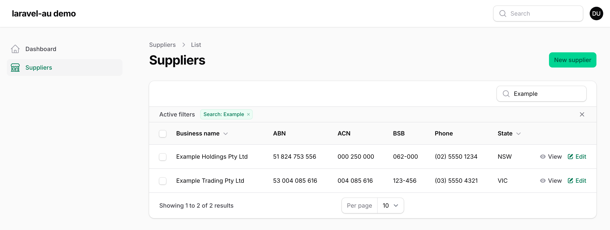

# Filament fields

This page is part of the [laravel-au](../README.md) docs. For setup, see
[Installation](../README.md#installation).

If your app uses Filament 4 or 5, these form fields bring the package's validation, formatting
and ABN Lookup into your forms. Filament is optional: the package doesn't require it, and
everything else works without it. The fields are building blocks for your own resource forms.
The package adds no pages, resources or plugin, so there's nothing to register.

```php
use EastpointLabs\LaravelAu\Filament\Forms\AbnInput;
use EastpointLabs\LaravelAu\Filament\Forms\AcnInput;
use EastpointLabs\LaravelAu\Filament\Forms\AuAddressFields;
use EastpointLabs\LaravelAu\Filament\Forms\AuPhoneInput;
use EastpointLabs\LaravelAu\Filament\Forms\BsbInput;
use Filament\Forms\Components\TextInput;
use Filament\Schemas\Schema;

public static function form(Schema $schema): Schema
{
    return $schema->components([
        AbnInput::make('abn')->lookup('business_name'),
        TextInput::make('business_name'),
        AcnInput::make('acn'),
        BsbInput::make('bsb'),
        AuPhoneInput::make('phone')->mobileOnly(),
        AuAddressFields::make('billing_'),
    ]);
}
```

The fields live in `EastpointLabs\LaravelAu\Filament\Forms`, and each one works with just
`make()`:

- `AbnInput` is masked as `51 824 753 556`, checked with the `Abn` rule and saved as 11 digits.
- `AcnInput` is masked as `004 085 616`, checked with the `Acn` rule and saved as 9 digits.
- `BsbInput` is masked as `062-000`, checked with the `Bsb` rule and saved as 6 digits.
- `AuPhoneInput` is a `tel` input that accepts mobiles and landlines. It saves in E.164, such as
  `+61491570006`, or as national digits (`0491570006`) when `phone.store_as` in `config/au.php`
  is `national`. Service numbers have no E.164 form, so they're always saved as national
  digits.
- `AuPostcodeInput` takes up to 4 characters, brings up the numeric keypad and is checked with
  the `AuPostcode` rule. It's saved as a string, so `0800` keeps its leading zero.
- `StateSelect` lists the eight states and territories by name, and saves the code (`NSW`,
  `VIC`...).

When a form loads a stored ABN, ACN, BSB or phone number, the field shows it formatted, such as
`51 824 753 556` or `0491 570 006`. A stored value that isn't valid is shown as it is.

## Phone and postcode options

`AuPhoneInput` takes the same choices as the [`AuPhone` rule](validation.md#phone-number-rules):

```php
AuPhoneInput::make('phone');                                      // mobile or landline
AuPhoneInput::make('phone')->mobileOnly();                        // mobile only
AuPhoneInput::make('phone')->landlineOnly();                      // landline only
AuPhoneInput::make('phone')->allowServiceNumbers();               // mobile, landline or service
AuPhoneInput::make('phone')->mobileOnly()->allowServiceNumbers(); // mobile or service
```

`allowServiceNumbers()` adds 13, 1300 and 1800 numbers, whichever order you call it in.

`AuPostcodeInput::forState()` checks the postcode against the state chosen in another field:

```php
StateSelect::make('state'),
AuPostcodeInput::make('postcode')->forState('state'),
```

With `NSW` chosen, `3000` fails with "The postcode must be in New South Wales." While the state
field is empty, or holds something that isn't a state, a postcode from any state passes.
`StateSelect` reports a bad state itself.

## Address fields

`AuAddressFields::make()` returns a two-column `Grid` holding the five fields of an address,
named with the prefix you give it. `AuAddressFields::make('billing_')` gives:

| Field                   | Label          | Required |
|-------------------------|----------------|----------|
| `billing_street_line_1` | Street address | Yes      |
| `billing_street_line_2` | Address line 2 | No       |
| `billing_suburb`        | Suburb         | Yes      |
| `billing_state`         | State          | Yes      |
| `billing_postcode`      | Postcode       | Yes      |

The street lines and suburb take the full width, with the state and postcode side by side. The
state is a `StateSelect`, and the postcode is checked against it with `forState()`. Without a
prefix, the fields are named `street_line_1`, `street_line_2` and so on. It's an ordinary
Filament `Grid`, so methods such as `->columnSpanFull()` chain on.

## Filling in the business name

`lookup()` saves people typing a name the register already has. In the example above,
`AbnInput::make('abn')->lookup('business_name')` looks the ABN up when the field loses focus,
and fills `business_name` with the first business name, else the entity name. That replaces
anything already in the field. It needs the `ABR_GUID` from
[Installation](../README.md#installation).

Only a valid ABN is looked up, and a lookup never breaks the form. When the ABN isn't on the
register, is suppressed and so has no name, or can't be looked up because no GUID is set or ABN
Lookup is unreachable, the other field is left as it is. A failed lookup is logged as a warning,
without the GUID. Successful lookups are cached like any other (see
[Caching and settings](abn-lookup.md#caching-and-settings)), so looking up the same ABN again
sends no request.

In tests, use `Abr::fake()` so no request is sent (see
[Testing your app](abn-lookup.md#testing-your-app)).
For a resource page such as `CreateSupplier`:

```php
use EastpointLabs\LaravelAu\Facades\Abr;
use Livewire\Livewire;

it('fills the business name from the ABN', function (): void {
    Abr::fake(['51824753556' => ['EntityName' => 'Example Holdings Pty Ltd']]);

    Livewire::test(CreateSupplier::class)
        ->fillForm(['abn' => '51 824 753 556'])
        ->assertSchemaStateSet(['business_name' => 'Example Holdings Pty Ltd']);
});
```

Only ABN Lookup errors are caught, so after `preventStrayLookups()` a test that looks up an ABN
you haven't configured still fails.

## Labels

Filament makes a label from the field name, so `abn` would be labelled "Abn". These fields set
their own, whatever the field is called: "ABN", "ACN", "BSB", "Phone", "Postcode" and "State",
plus "Street address", "Address line 2" and "Suburb" in `AuAddressFields`. `->label()` still
overrides them:

```php
AbnInput::make('supplier_abn')->label('Supplier ABN'),
```

The labels come from the package's translations, under `au::fields`, and are translated when
shown, so the current locale applies. To change or translate them, publish the translations
with the `au-translations` tag (see [Installation](../README.md#installation)) and edit
`lang/vendor/au/en/fields.php`.

## Table columns and infolist entries

These show stored values formatted, to match the form fields. The columns live in
`EastpointLabs\LaravelAu\Filament\Tables` and the entries in
`EastpointLabs\LaravelAu\Filament\Infolists`:

| Column          | Entry          | Example           |
|-----------------|----------------|-------------------|
| `AbnColumn`     | `AbnEntry`     | `51 824 753 556`  |
| `AcnColumn`     | `AcnEntry`     | `004 085 616`     |
| `BsbColumn`     | `BsbEntry`     | `062-000`         |
| `AuPhoneColumn` | `AuPhoneEntry` | `0491 570 156`    |
| `StateColumn`   | `StateEntry`   | `New South Wales` |



```php
use EastpointLabs\LaravelAu\Filament\Tables\AbnColumn;
use EastpointLabs\LaravelAu\Filament\Tables\AuPhoneColumn;
use EastpointLabs\LaravelAu\Filament\Tables\StateColumn;
use Filament\Tables\Table;

public static function table(Table $table): Table
{
    return $table->columns([
        AbnColumn::make('abn')->linkToAbnLookup(),
        AuPhoneColumn::make('phone')->dialable(),
        StateColumn::make('state')->abbreviated(),
    ]);
}
```

```php
use EastpointLabs\LaravelAu\Filament\Infolists\AbnEntry;
use EastpointLabs\LaravelAu\Filament\Infolists\AcnEntry;
use EastpointLabs\LaravelAu\Filament\Infolists\AuPhoneEntry;
use EastpointLabs\LaravelAu\Filament\Infolists\BsbEntry;
use EastpointLabs\LaravelAu\Filament\Infolists\StateEntry;
use Filament\Schemas\Schema;

public static function infolist(Schema $schema): Schema
{
    return $schema->components([
        AbnEntry::make('abn')->linkToAbnLookup(),
        AcnEntry::make('acn'),
        BsbEntry::make('bsb'),
        AuPhoneEntry::make('phone')->dialable(),
        StateEntry::make('state'),
    ]);
}
```

Each works with just `make()`. The value can be a plain stored string, or the value object or
`State` that an [Eloquent cast](casts-and-faker.md#eloquent-casts) gives you. A stored value
that doesn't parse, such as an ABN with a bad checksum, is shown as it is, never hidden. Each
has the same default label as its form field, such as "ABN" (see [Labels](#labels)), and
`->label()` overrides it.

`StateColumn` and `StateEntry` show the state's name. `->abbreviated()` shows its code, such as
`NSW`, which suits a narrow column.

`->linkToAbnLookup()` links an ABN to its page on ABN Lookup, such as
`https://abr.business.gov.au/ABN/View?abn=51824753556`, in a new tab. It's a public page, so no
GUID is needed. `->dialable()` makes a phone number a `tel:` link, so a click dials it. The link
uses E.164, such as `tel:+61491570156`, or the national digits for a service number, such as
`tel:1300975707`, because it has no E.164 form. Links are only built from a valid number, so a
value that doesn't parse gets no link.
